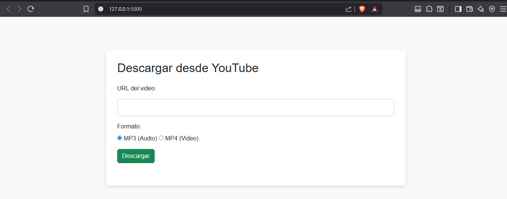
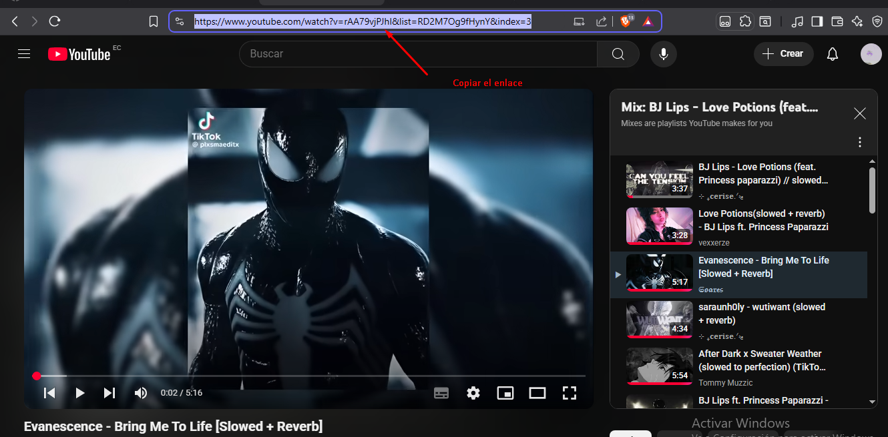
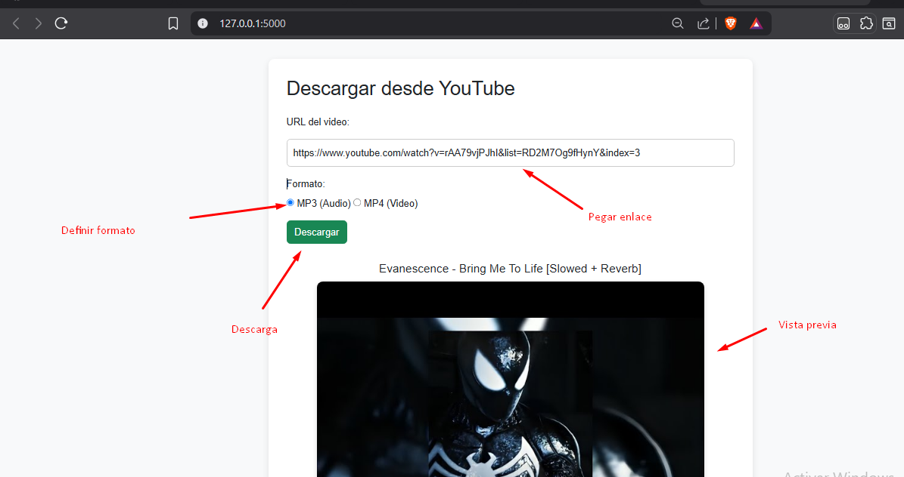
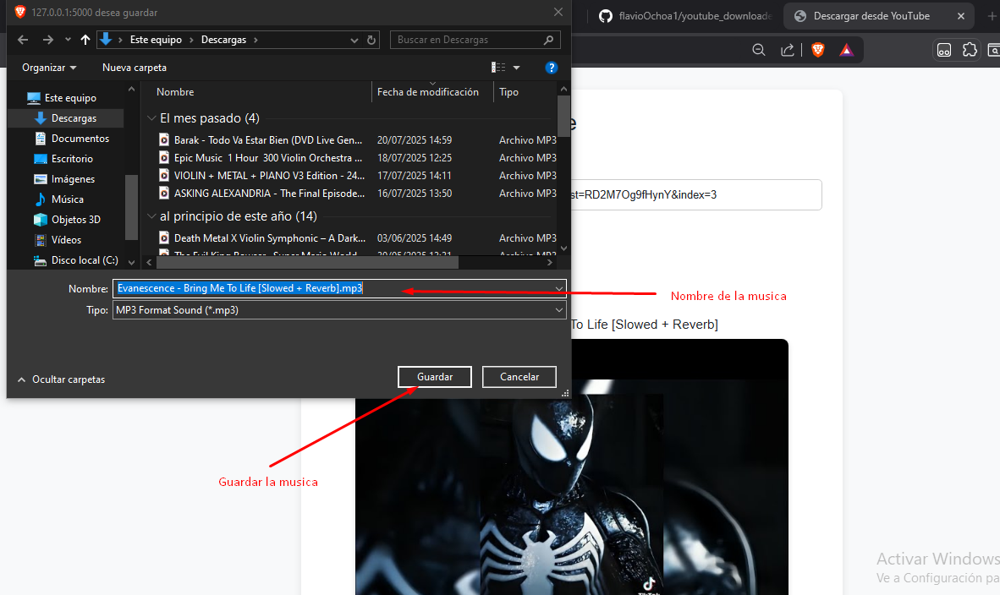

# YouTube Downloader Web 🎬🔻

Aplicación web que permite la descarga de videos de YouTube en formatos MP3 y MP4. Desarrollada con Python y Flask, esta herramienta facilita la conversión y descarga directa de contenidos audiovisuales mediante una interfaz sencilla y funcional.

---

## 🧰 Tecnologías utilizadas

- **Python 3.x**
- **Flask** – Framework web ligero
- **yt-dlp** – Para la extracción de datos y descarga desde YouTube
- **ffmpeg** – Para convertir audio/video a MP3 o MP4
- **HTML5 / CSS3** – Interfaz de usuario básica
- **Bootstrap (opcional)** – Para mejorar el diseño responsivo
- **Jinja2** – Motor de plantillas (incluido con Flask)

---

## 🚀 Funcionalidades

- Ingreso de URL de YouTube
- Extracción automática de información del video (título, miniatura, duración)
- Selección de formato de descarga: `.mp4` (video) o `.mp3` (audio)
- Descarga directa desde el navegador
- Validación de enlaces

---

## Solucion para el bloqueo de YouTube

Si aparece el error `Sign in to confirm you're not a bot`, YouTube esta bloqueando el cliente web normal. `ffmpeg` no soluciona ese bloqueo porque solo convierte el archivo; quien se conecta a YouTube es `yt-dlp`.

La app usa por defecto este ajuste en `config.properties`, que evita ese bloqueo en muchos videos:

```ini
YOUTUBE_PLAYER_CLIENT=android
```

Si un video sigue fallando, usa cookies como respaldo. La opcion mas estable en Windows es exportar cookies en formato Netscape a `cookies.txt` y configurar:

```ini
COOKIES_FILE=cookies.txt
```

Tambien se puede intentar leer cookies del navegador:

```ini
COOKIES_FROM_BROWSER=brave:Default
```

Si Brave/Chrome estan abiertos, Windows puede bloquear o impedir desencriptar esas cookies; en ese caso usa `cookies.txt`.

---

## 📷 Capturas de Pantalla

* Pantalla principal


* Copiar enlace


* Pegar enlace


* Guardar

